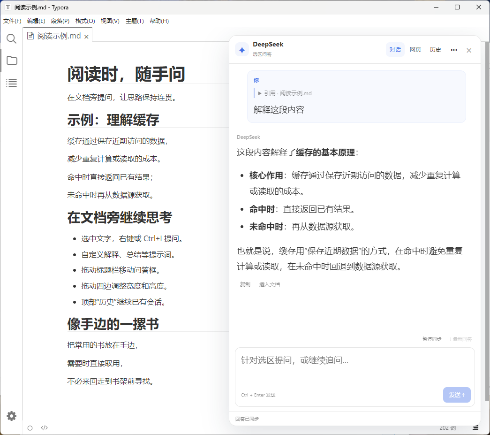
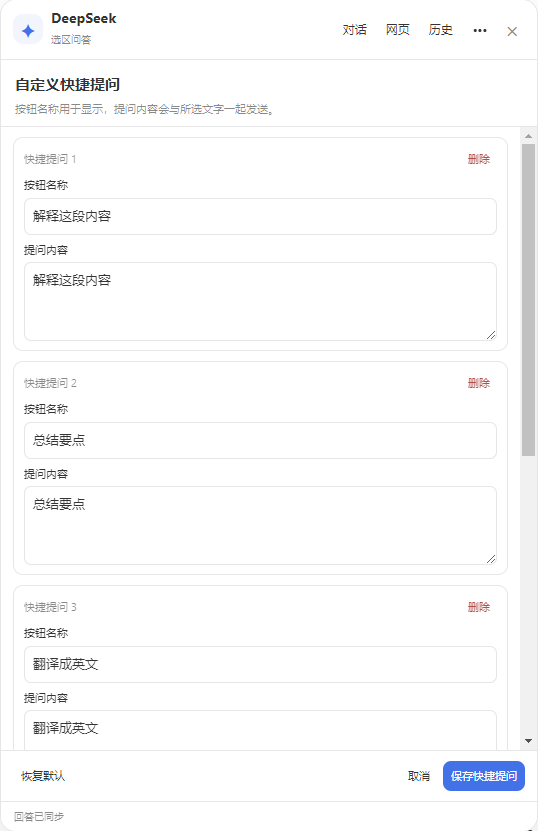
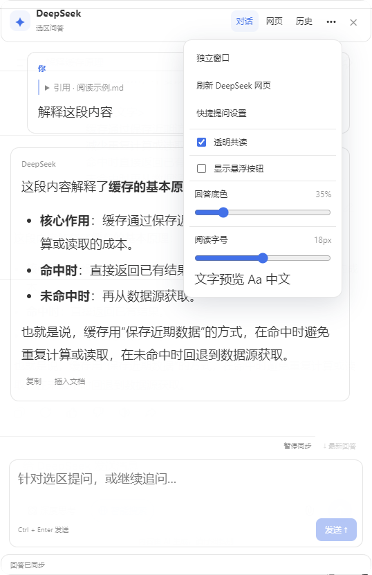

# typora-inline-deepseek

**在 Typora 中引用正文，直接与 DeepSeek 对话。**

面向 Windows 的选区问答插件。通过已登录的 DeepSeek 网页发送与接收问题，支持 Markdown、代码和公式，**不需要 API Key**。

[安装与上手](#安装与上手) · [功能说明](#功能说明) · [更多截图](#更多截图) · [开发](#开发) · [致谢](#致谢)

[](docs/screenshots/selection-chat.png)

## 你可以做什么

| 功能 | 说明 |
| --- | --- |
| 选区问答 | 引用正在阅读的段落提问，保留上下文，支持连续追问。 |
| 自定义提问 | 自定义解释、总结、翻译等快捷按钮的名称与完整提示词。 |
| 代码与公式 | 渲染 Markdown、表格与 KaTeX 公式，每个代码块支持一键复制。 |
| 自由布局 | 拖动标题栏移动窗口，拖动四边调节尺寸，支持透明共读。 |
| 网页历史 | 从顶部“历史”选择 DeepSeek 已保存的会话，继续提问。 |
| 独立窗口 | 将问答移到独立小窗，支持置顶、透明度及位置记忆。 |

## 安装与上手

### 运行要求

- Windows x64。
- Typora **1.5.0 或更新版本**。
- 已安装 [typora-community-plugin](https://github.com/typora-community-plugin/typora-community-plugin) 社区框架，版本 **2.7.1 或更新**。

本项目已在 Typora 1.9.5、社区框架 2.10.61 环境中使用。运行所需的 `dist/` 前端包、公式字体与 `bin/` 原生辅助程序均随项目提供，**安装和使用不需要 npm**。

### 安装插件

1. [下载项目 ZIP](https://github.com/rinkit7/typora-inline-deepseek/archive/refs/heads/main.zip) 并解压。
2. 保存文档，关闭所有 Typora 窗口，包括独立问答小窗。
3. 在解压后的项目目录打开 PowerShell，执行：

   ```powershell
   .\install.ps1
   ```

4. 重新打开 Typora，在正文中选中文字，右键选择 **DeepSeek 问答**，或按 **Ctrl+I**。
5. 首次使用或登录过期时，点击顶部 **网页**，自行登录 DeepSeek，再回到 **对话**。

安装器默认使用 `%USERPROFILE%/.typora/community-plugins`，可通过 `-CommunityDirectory` 指定其他社区框架目录。插件安装在其 `plugins/typora-inline-deepseek` 下，插件 ID 为 `typora-inline-deepseek`。

安装器保留插件的 `data/` 和其他插件，旧安装及启用设置备份在社区框架的 `backups/typora-inline-deepseek/`。如果旧版使用不同的插件 ID，请先停用旧版，避免重复加载。也可以手动将项目放入社区框架的 `plugins/typora-inline-deepseek`，再在社区插件设置中启用。

### 第一次提问

1. 选中正文，按 **Ctrl+I** 或右键打开问答。引用会出现在输入框上方，可展开或移除。
2. 输入问题，点击 **发送** 或按 **Ctrl+Enter**。普通 **Enter** 用于换行。
3. 在文档旁阅读回答，继续追问；需要时复制回答或插入文档。

回答生成期间可以编辑下一条问题，发送需等待当前回答结束。发送失败会保留引用和草稿，不自动重复发送。

## 功能说明

### 顶部入口与常用操作

| 入口 | 用途 |
| --- | --- |
| **对话** | 阅读回答、编辑问题、复制代码或插入文档。 |
| **网页** | 登录 DeepSeek、查看完整会话，或操作网页上的停止生成。 |
| **历史** | 筛选、刷新并选择网页已经加载的历史会话。 |
| **··· 更多** | 设置快捷提问、悬浮按钮、透明共读、字号及独立窗口。 |

- **复制代码**：代码块上方有独立按钮，只复制当前块的纯代码，保留缩进与换行；成功后显示“已复制”。回答下方的“复制”仍用于复制整段回答。
- **插入文档**：插入前会校验原文档内容和位置。目标失效时，请复制后手动插入；重新选区不会把较早的回答插到新位置。
- **暂停同步**：暂停本地回答采集，便于阅读和选字；它不会取消 DeepSeek 生成。点击“最新回答”可滚动到底部。

### 自定义快捷提问

附加选区后，点击快捷按钮旁的 **自定义**，或打开 **更多 → 快捷提问设置**。

- 可修改按钮名称与完整提示词，也可新增、删除或恢复默认。
- 保存后立即生效，重启后保留；选中文字会自动附加到问题中。
- 最多 20 个按钮，名称最多 24 字，提示词最多 4000 字。
- 删除全部按钮并保存可隐藏预设入口，之后仍可从“更多”重新配置。

### 窗口与阅读设置

| 操作 | 效果 |
| --- | --- |
| 拖动标题栏 | 整体移动问答框，保持高度。 |
| 拖动左右边框 | 调节宽度，范围 300–640px，受可用屏幕空间约束。 |
| 拖动上下边框 | 调节高度，最小 320px，受可用屏幕空间约束。 |
| 聚焦边框后按方向键 | 沿对应方向调节尺寸；按住 Shift 每次调节 40px。 |
| 更多 → 透明共读 | 调整回答底色，空白区域允许操作正文。 |
| 更多 → 阅读字号 | 提问前即可调节，提供即时预览，引用和输入框同步变化。 |
| 更多 → 显示悬浮按钮 | 显示或隐藏右下角的问答入口，默认开启。 |

移动与缩放实时更新，尺寸在松手后记住；默认高度为 640px。Typora 窗口暂时缩小时，仅限制显示尺寸，恢复空间后回到保存的高度。高度较小时，引用和输入区域可滚动。

隐藏悬浮按钮后，仍可通过选区右键或 **Ctrl+I** 打开问答，再从“更多”重新开启。悬浮按钮有新选区时附加引用，没有新选区时恢复原会话；切换文档后旧引用不能作为新文档的引用发送。

### 网页历史会话

点击顶部 **历史**，按标题筛选并选择 DeepSeek 网页端保存的会话。切换后会打开对应网页，将网页当前显示的最近回答同步到插件，并保留未发送的草稿和正文引用，方便继续提问。

- 日期优先使用网页提供的会话时间，显示为 `YYYY-MM-DD`；也支持“今天／昨天”等日期分组。
- “过去 7 天”等范围只显示分组，不猜测具体日期。没有时间信息时显示“日期未知”。
- 列表仅包含网页已加载的会话。找不到记录时，点击 **在网页查看完整历史**，在侧栏展开或加载更多，再返回列表刷新。
- 完整的多轮问答、分支和更早的消息在网页查看，插件不承诺一次导入全部网页记录。
- 历史回答没有有效的原文插入位置时，只提供复制。

历史持久化由 DeepSeek 网页端负责，插件**不建立本地聊天历史库，也不导出登录令牌**。退出后可重新从网页历史选择会话；当前窗口中的对话在关闭卡片后仍保留。启动时没有新引用或草稿，界面可显示网页最近回答并标明来源。

### 独立窗口

打开 **更多 → 独立窗口**，在小窗中通过 **移回文档** 返回。引用、草稿与当前对话随窗口转移；请等回答结束后再切换，因为切换时会重新打开当前 DeepSeek 会话页面。

- 小窗隐藏 Typora 的菜单栏、文档标签与侧栏，只保留系统标题栏和聊天界面，标题显示“DeepSeek 问答”。
- 拖动聊天头移动窗口，使用系统边框调整大小；支持置顶、位置记忆和系统整窗透明度。
- 分层透明共读在原文档内使用，独立小窗采用整窗透明度。
- 最小化后，从原文档重新选区提问可恢复并置前小窗，同时附加新选区；没有新选区时只恢复窗口。

## 更多截图

以下设置面板以原始像素单独拍摄，使用无损 PNG 保存。点击图片可查看原图。

<details>
<summary><strong>自定义快捷提问</strong>：编辑按钮名称与完整提示词</summary>

[](docs/screenshots/custom-prompts.png)

</details>

<details>
<summary><strong>透明共读与阅读设置</strong>：调整回答底色和字号</summary>

[](docs/screenshots/transparent-reading.png)

</details>

## 数据与常见问题

窗口桥接与偏好保存在已安装插件的 `data/`。**桥接文件可能包含引用、草稿和对话内容，分享源码时不要包含 `data/`。** 诊断仅记录版本、事件、是否有引用和消息数量等信息，不记录正文、问题或账号。

本机安装记录 `installation.json`、根目录的 `runtime-status.json`、旧 ZIP 归档与 `.bundle` 历史包也不属于发布内容，均应排除；不要直接公开包含这些文件的上层工作目录。

<details>
<summary>Windows 上拖动或滚动明显卡顿</summary>

可单独测试以 `--disable-renderer-accessibility` 参数启动 Typora，本项目的测试环境曾通过这一方式改善卡顿。此参数会影响屏幕阅读器和依赖无障碍接口的工具。

确认有效后，可在 Typora 高级配置中将空的 `flags` 改为 `[["disable-renderer-accessibility"]]`；已有其他参数时应保留。安装器不会修改这项配置。

</details>

<details>
<summary>诊断文件与原生窗口辅助程序</summary>

- `data/drag-performance.json`：拖动事件数、帧等待时间和被隔离的兼容鼠标事件数，不记录正文或坐标。
- `data/runtime-status.json`：运行状态与 `native-capture-v1` 拖动引擎标记，可用于确认加载版本。
- 内部会话标识位于桥接文件名和窗口属性中，供原生辅助程序定位窗口。

</details>

DeepSeek 网页不是稳定的插件 API，网页改版可能影响登录、发送或采集。网页视图始终保留，用于检查状态。Markdown 中的原始 HTML 不进入插件界面，链接按文字展示，不在 Typora 中直接导航；实际视觉效果和鼠标命中仍需在 Typora 中确认。

## 开发

前端使用 assistant-ui、React 和 Markdown/KaTeX 组件，开发与测试需要 **Node.js 22 或更新版本**。依赖版本由 `package-lock.json` 固定。

```powershell
npm ci --ignore-scripts --cache .\.cache\npm
npm run build
npm run check
npm test
```

重新编译 Windows x64 原生辅助程序：

```powershell
.\scripts\build-native.ps1
```

| 目录或模块 | 职责 |
| --- | --- |
| `src/workspace-controller.js` | 工作区、菜单、窗口与插入路由。 |
| `src/selection-tracker.js` | 选区捕获、焦点变化与文档失效处理。 |
| `src/chat-session.js` | 引用、草稿、消息、发送与同步状态。 |
| `src/deepseek-web.js`、`src/web-provider.js`、`src/web-history.js` | 隔离网页适配、发送确认与历史列表。 |
| `ui/` | assistant-ui 界面及 Shadow DOM 样式。 |
| `src/detached-session.js`、`native/`、`bin/` | 窗口桥接、原生辅助程序源码与可执行文件。 |
| `dist/` | 前端构建、KaTeX 字体与第三方许可证。 |
| `scripts/`、`test/` | 构建、资源检查与自动化测试。 |

## 致谢

感谢 [KokuYu-sysu/AI4Typora](https://github.com/KokuYu-sysu/AI4Typora)。本项目最初基于该项目的本地定制版本开发，后续逐步演进为当前的 DeepSeek 选区问答插件。原作者及历史来源的 MIT 许可保留在 [THIRD_PARTY_NOTICES.md](THIRD_PARTY_NOTICES.md) 中。

同时感谢 [typora-community-plugin](https://github.com/typora-community-plugin/typora-community-plugin)、[assistant-ui](https://github.com/assistant-ui/assistant-ui)、React、KaTeX 及其他依赖的贡献者。

感谢 Linux.do 社区提供的交流与分享平台。友情链接：[Linux.do](https://linux.do/)。

## 许可与来源

本项目采用 [MIT 许可](LICENSE)。历史来源记录与原项目许可见 [THIRD_PARTY_NOTICES.md](THIRD_PARTY_NOTICES.md)，构建依赖的许可见 [dist/THIRD-PARTY-LICENSES.txt](dist/THIRD-PARTY-LICENSES.txt)。

这是从历史定制版本独立整理的项目，不声称与原项目没有历史关联；当前前端使用 assistant-ui 组件库，并非重新引入原 AI4Typora 的业务源码。构建记录位于 `dist/build-info.json`。
