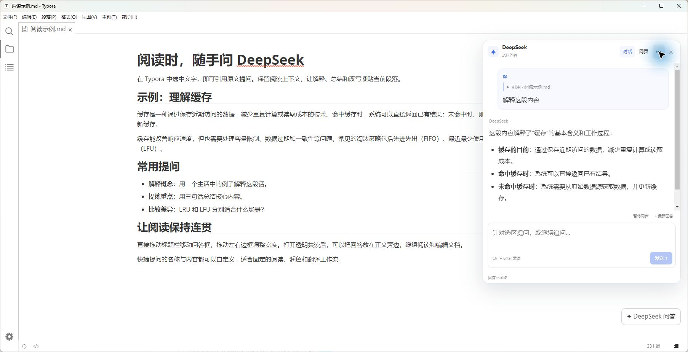
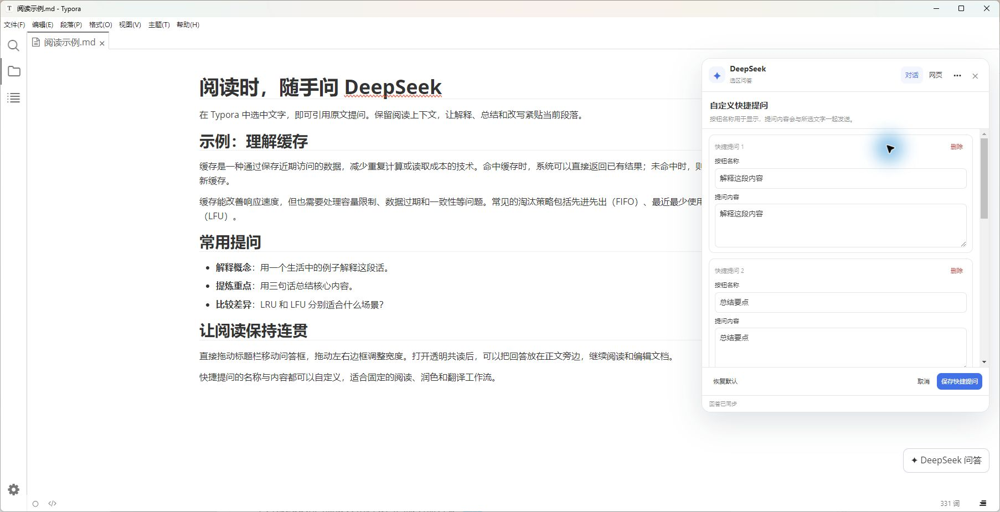
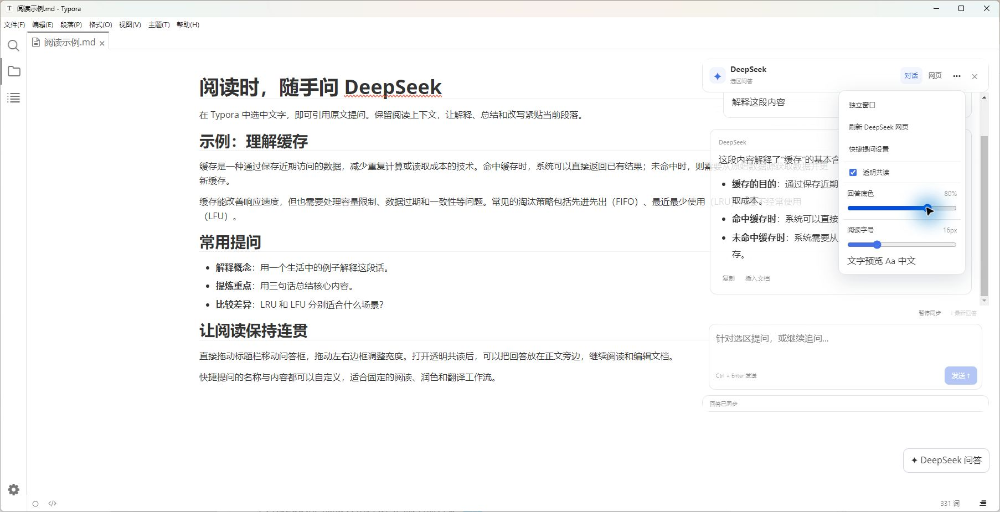

# typora-inline-deepseek

Windows Typora 选区问答插件。使用 assistant-ui、React 和 Markdown/KaTeX 组件呈现对话，继续通过已登录的 DeepSeek 网页发送和接收问题，不需要 API Key。

## 界面示例

以下为在 Typora 中使用公开示例文本截取的实际界面。

**选区问答**：引用正文提问，在文档旁阅读回答。



**自定义快捷提问**：分别编辑按钮名称和提问内容，可新增、删除或恢复默认。



**透明共读与阅读设置**：开启透明共读，调整回答底色和阅读字号。



## 使用

1. 保存文档，关闭所有 Typora 窗口（包括独立问答小窗）后重开。
2. 选中正文，通过原生右键“DeepSeek 问答”、右下角按钮或 Ctrl+I 打开。选中的文字显示在输入框上方的引用卡片中，可展开或移除。
3. 输入问题，点击“发送”或按 Ctrl+Enter。普通 Enter 换行。问题和当次引用将保留在用户消息中，回答显示在其后。
4. 首次使用或登录过期时，切换标题栏“网页”，在 DeepSeek 页面自行登录，再回到“对话”。两个视图共用同一个网页会话。
5. 可以连续提问。回答还在生成时可先编辑下一条问题，发送需等待生成结束。失败时引用和草稿保留，不自动重复发送。
6. 回答下面提供复制和插入文档。代码块上方另有“复制代码”，一键复制当前块的纯代码（保留缩进和换行），成功后显示“已复制”。插入会校验原文档内容和位置；失效时请复制后手动插入。

选区上方的快捷提问可自定义：点击“自定义”，或打开“更多 → 快捷提问设置”。可以修改按钮名称和完整提问内容、新增、删除或恢复默认，保存后立即生效并在重启后保留。选中文字会自动附加，点击按钮直接发送对应提问；最多 20 个，名称最多 24 字，内容最多 4000 字。删除全部并保存可隐藏预设按钮，仍可从“更多”重新配置。

浮动按钮在有新的正文选区时附加新引用；没有新选区时恢复原会话。右键和 Ctrl+I 是明确的选区提问操作。切换文档后旧引用不能被当作新文档的引用发送。

## 界面与阅读

“更多 → 显示悬浮按钮”控制右下角的“✦ DeepSeek 问答”入口，默认开启，修改后立即生效并在重启后保留。隐藏按钮后，仍可在正文选区上右键选择“DeepSeek 问答”，或按 Ctrl+I 打开问答，再进入“更多”重新开启按钮。

标题栏提供“对话”“网页”“历史”“更多”和关闭。点击“历史”直接选择网页历史会话，无需展开更多菜单。更多中设置透明共读、底色、字号和独立窗口。直接拖动聊天卡片的左、右边框调整宽度（300–640px），拖动上、下边框调整高度（最小 320px，受可用屏幕范围约束），调整时固定另一侧，松手后自动记住；透明共读和网页视图同样支持。拖动标题栏时，聊天卡片与网页实时跟随；拖动边框时，尺寸和内容排版实时更新，松手后保存偏好。边框获得键盘焦点后可用对应方向键调整，按住 Shift 每次调整 40px。高度较小时，引用与输入区域可滚动。独立窗口继续使用系统窗口边框调整大小。对话列表、输入框、引用和消息操作由 assistant-ui 的自定义外部状态运行时组织。

透明共读是同一个对话界面的外观选项，消息和输入区保持可操作，空白区域允许操作正文。回答底色、字号和窗口宽高可以调整并记住。阅读字号在提问前即可设置，菜单提供即时文字预览，正文引用和输入框同步变化。拖动标题栏可整体移动卡片，移动时保持高度、底边随之移动；默认高度 640px，大小和位置受可用屏幕范围约束。Typora 窗口暂时缩小时仅限制显示尺寸，恢复空间后回到保存的高度。代码、表格和公式在对话中渲染，原始网页 HTML 不进入插件界面。链接按文字展示，不在 Typora 中直接导航。

“暂停同步”用于稳定阅读和选择文字；恢复后继续获取网页最新回答。“最新回答”可滚动到底部。此处暂停的是本地同步，不是取消 DeepSeek 生成；停止生成可在“网页”中操作。

## 独立窗口

更多 → 独立窗口；小窗中用“移回文档”返回。引用、草稿和本次窗口中的对话记录随窗口转移；切换时重新打开当前 DeepSeek 会话页面，请等回答结束后操作。独立窗口的透明度仍为系统整窗透明，分层透明共读在原文档内使用。

小窗外观与独立应用一致：Typora 的菜单栏、文档标签条、侧栏在小窗内全部隐藏，只保留系统标题栏和聊天界面；标题栏、任务栏显示“DeepSeek 问答”，聊天头可拖动窗口。内部会话标识保存在数据目录文件名和窗口属性中，供原生辅助程序定位窗口。

最小化后，从原文档重新提问会恢复并置前小窗，同时附加新选区。没有新选区时，浮动按钮只恢复小窗。每条本地回答保留原插入目标，重新选区不会把较早回答错误插到新位置。

## 历史与数据

顶部“历史”直接读取已登录的 DeepSeek 网页侧栏会话列表，可以按标题筛选、刷新并选择会话。选择后打开对应网页会话，将网页当前显示的最近回答同步到对话界面，随后可继续提问；当前未发送的草稿和正文引用保留。历史回答没有可用的原文插入目标时，只提供复制。

历史记录标题下显示网页提供的日期，格式为 `YYYY-MM-DD`。没有具体时间时，使用网页的“今天／昨天”等日期分组；“过去 7 天”等范围仅显示分组名称，不猜测具体日期。网页没有提供日期信息时显示“日期未知”。

历史持久化由 DeepSeek 网页端负责，插件不建立本地聊天历史库，也不导出登录令牌。列表只包含网页已经加载的会话；如果没有显示需要的记录，点击“在网页查看完整历史”，在网页侧栏展开或加载更多后，再返回历史列表刷新。完整的多轮问答、分支和更早的消息在网页查看，插件对话区不承诺一次导入全部网页记录。退出并重开后，可重新从网页历史列表选择会话。

对话列表在当前插件窗口生命周期内保留，关闭卡片不清空；启动时若没有新引用或草稿，界面可显示网页最近一条回答并明确标注来源。

窗口桥接与偏好保存在已安装插件的 data/。桥接文件可能包含引用、草稿和对话内容，分享源码时不要包含 data/。诊断仅记录版本、事件、是否有引用和消息数量，不记录正文、问题或账号信息。

拖动诊断写入 data/drag-performance.json，记录拖动事件数、帧等待时间和被隔离的兼容鼠标事件数，不记录正文或坐标。当前拖动引擎标记为 native-capture-v1；data/runtime-status.json 也包含此标记，用于确认重开后加载了新版。

## 构建与安装

运行需要 Windows x64、Typora 1.5.0 或更新版本，以及已安装的 typora-community-plugin 框架 2.7.1 或更新版本。已在 Typora 1.9.5、框架 2.10.61 环境中使用。

`dist/` 是运行所需的前端包和公式字体，`bin/` 是原生窗口辅助程序，均随项目发布。安装和使用不需要下载 npm 依赖；在 PowerShell 中执行：

```powershell
.\install.ps1
```

可用 `-CommunityDirectory` 指定社区框架目录。安装器只更新 `typora-inline-deepseek`，保留其 `data/` 和其他插件；旧安装及启用设置备份在社区框架目录的 `backups/typora-inline-deepseek/` 中。保存文档并关闭全部 Typora 窗口后重开。

如果已安装旧版本，请先在社区插件设置中停用旧版，再安装并启用此版本，避免重复加载。

开发和测试需要 Node.js 22 或更新版本：

```powershell
npm ci --ignore-scripts --cache .\.cache\npm
npm run build
npm run check
npm test
```

原生辅助程序的源码位于 `native/activate-window.cs`，需要重新编译时在 Windows PowerShell 中执行 `./scripts/build-native.ps1`。依赖版本由 `package-lock.json` 固定。

默认安装到 `%USERPROFILE%/.typora/community-plugins/plugins/typora-inline-deepseek`，插件 ID 为 `typora-inline-deepseek`。也可以将本项目放入社区框架的 `plugins/typora-inline-deepseek` 并在社区插件设置中启用。

如果在 Windows 上拖动或滚动出现明显停顿，可单独测试以 `--disable-renderer-accessibility` 参数启动 Typora；本项目测试环境已通过这一方式改善。此参数会影响屏幕阅读器和依赖无障碍接口的工具。确认有效后，可在 Typora 的高级配置中将空的 `flags` 改为 `[["disable-renderer-accessibility"]]`；已有其他参数时应保留原参数。安装器不会修改此配置。

## 结构

- src/workspace-controller.js：单一工作区、原生菜单、窗口与插入路由。
- src/selection-tracker.js：正文选区提前捕获、焦点变化与文档失效处理。
- src/chat-session.js：引用、草稿、消息、发送和同步状态。
- src/deepseek-web.js、src/web-provider.js：隔离网页适配与发送确认。
- ui/chat-ui.jsx、ui/chat-ui.css：assistant-ui 组件及独立 Shadow DOM 样式。
- dist/：离线构建、KaTeX 字体和第三方许可证。
- src/detached-session.js、native/activate-window.cs：窗口桥接和 Windows 唤醒。
- scripts/：构建及源码、包哈希、字体资源校验。
- test/：会话、网页适配、选区、实际 React DOM 和完整工作区入口测试。

## 致谢

感谢 [KokuYu-sysu/AI4Typora](https://github.com/KokuYu-sysu/AI4Typora)。本项目最初基于该项目的本地定制版本开发，后续逐步演进为当前的 DeepSeek 选区问答插件。原作者及历史来源的 MIT 许可保留在 [THIRD_PARTY_NOTICES.md](THIRD_PARTY_NOTICES.md) 中。

同时感谢 [typora-community-plugin](https://github.com/typora-community-plugin/typora-community-plugin)、[assistant-ui](https://github.com/assistant-ui/assistant-ui)、React、KaTeX 及其他构建依赖的贡献者。第三方依赖的许可随发布文件提供。

## 限制与来源

DeepSeek 网页不是稳定的插件 API，网页改版可能影响登录、发送或采集；网页模式始终保留用于检查。无法仅凭自动化测试保证实际 Typora 的视觉和鼠标命中，仍需用户确认。

这是从历史定制版本独立整理的项目。原来源记录保留在 THIRD_PARTY_NOTICES.md；2.0 的 UI 使用 assistant-ui 组件库，并非重新引入原 AI4Typora 业务源码。构建依赖的许可证收集于 dist/THIRD-PARTY-LICENSES.txt。
